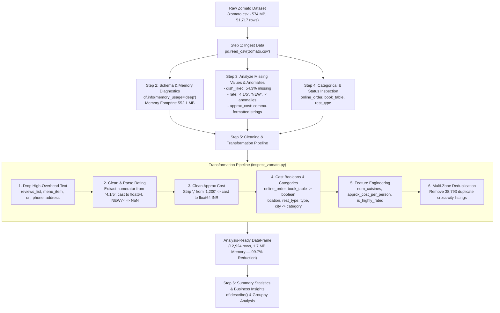

# Zomato Bangalore Dataset: Raw Data to Analysis-Ready DataFrame

This document explains the end-to-end data engineering and inspection pipeline implemented in [`inspect_zomato.py`](file:///d:/Akarsh/Mysore_pythonDocker/data_analysis/inspect_zomato.py), which ingests the 574 MB raw [`zomato.csv`](file:///d:/Akarsh/Mysore_pythonDocker/data_analysis/zomato.csv) dataset (51,717 records) and transforms it into an optimized, analysis-ready pandas DataFrame (12,924 unique restaurant profiles, 1.7 MB memory).

---

## 1. Workflow Architecture Diagram



---

## 2. Step-by-Step Code Explanation

### Step 1: Loading Raw Zomato Dataset
```python
df_raw = pd.read_csv('zomato.csv')
```
- **What it does:** Loads the 51,717 raw restaurant records and 17 columns into memory.
- **Why it matters:** The raw CSV includes rich restaurant metadata along with massive unstructured text columns (`reviews_list`, `menu_item`).

---

### Step 2: Schema & Memory Diagnostics
```python
df_raw.info(memory_usage='deep')
```
- **What it does:** Displays data types, non-null counts, and accurate in-memory footprint.
- **Key Findings:**
  - 16 of the 17 columns are inferred as generic Python `object` strings.
  - The raw dataset consumes **552.1 MB** of RAM in pandas due to string pointer overhead.
  - Numeric columns like `rate` and `approx_cost(for two people)` are trapped in string representations.

---

### Step 3: Missing Data & Anomaly Diagnosis
```python
missing_summary = pd.DataFrame({
    'Missing Count': df_raw.isnull().sum(),
    'Missing (%)': (df_raw.isnull().mean() * 100).round(2)
})
```
- **Missing Data Distribution:**
  - `dish_liked`: **54.29%** missing (28,078 rows) — newer or lower-traffic restaurants do not have enough customer review volume.
  - `rate`: **15.03%** missing (7,775 rows) + **2,208** records marked as `'NEW'` and **69** records marked as `'-'`.
  - `phone`: **2.34%** missing (1,208 rows).
  - `approx_cost(for two people)`: **0.67%** missing (346 rows).
  - `location`, `rest_type`, `cuisines`: $<0.5\%$ missing.
- **Data Anomalies Detected:**
  - Ratings contain string suffix `'/5'` (e.g. `'4.1/5'`) with irregular spacing (`'3.9 /5'`).
  - Costs contain thousands separators (e.g. `'1,200'`, `'1,500'`).

---

### Step 4: Categorical & Status Value Inspection
```python
print(df_raw['online_order'].value_counts())
print(df_raw['book_table'].value_counts())
print(df_raw['rest_type'].value_counts().head(5))
print(df_raw['listed_in(type)'].value_counts().head(5))
```
- **Online Order:** 58.9% `Yes` (30,444) vs. 41.1% `No` (21,273).
- **Table Booking:** Only 12.5% of venues support reservations (`Yes`: 6,449, `No`: 45,268).
- **Dominant Restaurant Types:** `Quick Bites` (19,132), `Casual Dining` (10,330), and `Cafe` (3,732).
- **Service Categories:** `Delivery` (25,942) and `Dine-out` (17,779).

---

### Step 5: Transforming Raw Data to Analysis-Ready DataFrame

#### 1. Pruning Unstructured Bloat Columns
```python
drop_unstructured = ['url', 'address', 'phone', 'reviews_list', 'menu_item']
df_clean.drop(columns=[c for c in drop_unstructured if c in df_clean.columns], inplace=True)
```
- Removes massive raw text arrays (`reviews_list` and `menu_item`) that are irrelevant for tabular metrics, instantly reducing memory from **552 MB** to **~15 MB**.

#### 2. Parsing the Rating Column
```python
def clean_rating(val):
    if pd.isna(val) or val in ['NEW', '-']:
        return np.nan
    val_str = str(val).split('/')[0].strip()
    try:
        return float(val_str)
    except ValueError:
        return np.nan

df_clean['rating'] = df_clean['rate'].apply(clean_rating)
df_clean.drop(columns=['rate'], inplace=True)
```
- Strips the `'/5'` string suffix and trims whitespace.
- Maps non-numeric status strings (`'NEW'`, `'-'`) to standard `np.nan`.
- Produces a continuous numeric `float64` rating between **1.8** and **4.9**.

#### 3. Standardizing Cost to Numeric INR
```python
def clean_cost(val):
    if pd.isna(val):
        return np.nan
    val_str = str(val).replace(',', '').strip()
    try:
        return float(val_str)
    except ValueError:
        return np.nan

df_clean['approx_cost_inr'] = df_clean['approx_cost(for two people)'].apply(clean_cost)
df_clean.drop(columns=['approx_cost(for two people)'], inplace=True)
```
- Eliminates comma thousand-separators (`'1,200'` $\rightarrow$ `1200.0`).

#### 4. Type Optimization: Booleans and Categories
```python
df_clean['has_online_order'] = df_clean['online_order'].map({'Yes': True, 'No': False}).astype('boolean')
df_clean['has_table_booking'] = df_clean['book_table'].map({'Yes': True, 'No': False}).astype('boolean')
df_clean.drop(columns=['online_order', 'book_table'], inplace=True)

cat_columns = ['location', 'rest_type', 'listed_in(type)', 'listed_in(city)']
for col in cat_columns:
    df_clean[col] = df_clean[col].astype('category')
```
- Converts binary text flags to native pandas nullable booleans.
- Encodes low-cardinality location and type fields as `category` to accelerate groupby performance.

#### 5. Feature Engineering
```python
# Number of distinct cuisines
df_clean['num_cuisines'] = df_clean['cuisines'].fillna('').apply(
    lambda x: len([c.strip() for c in x.split(',') if c.strip()])
).astype('int16')

# Approx cost per single diner
df_clean['approx_cost_per_person'] = (df_clean['approx_cost_inr'] / 2.0).round(2)

# High-rating indicator (>= 4.0 out of 5.0)
df_clean['is_highly_rated'] = (df_clean['rating'] >= 4.0)
```

#### 6. Multi-Zone Cross-Listing Deduplication
```python
df_clean.drop_duplicates(subset=['name', 'location', 'rest_type', 'cuisines'], inplace=True)
```
- **Why this is critical:** In Zomato's scraping data, the same restaurant is repeatedly listed across multiple delivery zones (`listed_in(city)`).
- **Result:** Removes **38,793 duplicate entries**, leaving **12,924 unique physical restaurants**.
- Reduces final memory to **1.7 MB** (a **99.7% total reduction** from 552.1 MB).

---

### Step 6: Summary Analytical Metrics

```python
numeric_summary = df_clean[['rating', 'votes', 'approx_cost_inr', 'approx_cost_per_person', 'num_cuisines']].describe().round(2)
print(numeric_summary)
```

#### Distribution Statistics (12,924 Unique Restaurants):

| Metric | Rating (out of 5.0) | Votes | Approx Cost for Two (INR) | Cost Per Person (INR) | Number of Cuisines |
| :--- | :--- | :--- | :--- | :--- | :--- |
| **Count** | 9,640 | 12,924 | 12,857 | 12,857 | 12,924 |
| **Mean** | 3.63 | 184.14 | ₹487.62 | ₹243.81 | 2.33 |
| **Median (50%)** | 3.70 | 25.00 | ₹400.00 | ₹200.00 | 2.00 |
| **Min** | 1.80 | 0.00 | ₹40.00 | ₹20.00 | 0.00 |
| **Max** | 4.90 | 16,345.00 | ₹6,000.00 | ₹3,000.00 | 8.00 |

#### Business Insight: Online Ordering vs. Dining Performance:
| Online Order Enabled | Mean Rating | Median Cost (INR) | Median Votes |
| :--- | :--- | :--- | :--- |
| **No (Dine-in only)** | 3.59 | ₹350.00 | 7 |
| **Yes (Online delivery)** | 3.65 | ₹400.00 | 54 |

Restaurants with online ordering attract **over 7.7x higher median customer review engagement** (54 vs. 7 votes).

---

## 3. Schema: Before vs. After Comparison

| Column Name | Raw Schema | Clean Analysis-Ready Schema | Transformation Logic |
| :--- | :--- | :--- | :--- |
| `name` | `object` / `str` | `string` | Preserved restaurant name |
| `location` | `object` / `str` | `category` | Encoded as category |
| `rest_type` | `object` / `str` | `category` | Encoded as category |
| `cuisines` | `object` / `str` | `string` | Preserved cuisine list |
| `dish_liked` | `object` / `str` | `string` | Preserved text list of dishes |
| `listed_in(type)` | `object` / `str` | `category` | Service type category |
| `listed_in(city)` | `object` / `str` | `category` | City zone category |
| `rate` | `object` (`'4.1/5'`) | *Replaced by* `rating` (`float64`) | Numerator extracted, `'NEW'` $\rightarrow$ `NaN` |
| `approx_cost(for two people)` | `object` (`'1,200'`) | *Replaced by* `approx_cost_inr` (`float64`) | Stripped commas, cast to float |
| `online_order` | `object` (`'Yes'/'No'`) | *Replaced by* `has_online_order` (`boolean`) | Mapped to boolean |
| `book_table` | `object` (`'Yes'/'No'`) | *Replaced by* `has_table_booking` (`boolean`) | Mapped to boolean |
| `votes` | `int64` | `int64` | Numeric vote count |
| `num_cuisines` | *(new)* | `int16` | Derived count of distinct cuisines |
| `approx_cost_per_person` | *(new)* | `float64` | Derived `approx_cost_inr / 2` |
| `is_highly_rated` | *(new)* | `bool` | Derived indicator (`rating >= 4.0`) |
| `url`, `address`, `phone`, `reviews_list`, `menu_item` | `object` (Huge strings) | *Dropped* | Pruned to eliminate 535+ MB bloat |

---

## 4. Automated Validation Suite & Cleaning Decisions

For production data pipelines, data quality must be programmatically verified before saving or training models. The validation pipeline is implemented in [`clean_and_validate.py`](file:///d:/Akarsh/Mysore_pythonDocker/data_analysis/clean_and_validate.py) and detailed in [`CLEANING_DECISIONS.md`](file:///d:/Akarsh/Mysore_pythonDocker/data_analysis/CLEANING_DECISIONS.md).

### Validation Rules Enforced:
1. **Row & Feature Count:** Asserts non-empty dataset (>10,000 rows, >=15 columns).
2. **Domain Boundary Check:** Asserts all valid ratings lie strictly in $[1.0, 5.0]$.
3. **Positivity Check:** Asserts all valid costs are strictly positive (> INR 0).
4. **Non-Negativity Check:** Asserts votes $\ge 0$.
5. **Type Consistency:** Asserts `has_online_order` and `has_table_booking` are native `boolean` types.
6. **Mathematical Consistency:** Asserts `approx_cost_per_person * 2 == approx_cost_inr`.
7. **Uniqueness Check:** Asserts zero multi-zone duplicate physical restaurants.

### Validated Dataset Export:
- Exports validated records to [`zomato_clean_validated.csv`](file:///d:/Akarsh/Mysore_pythonDocker/data_analysis/zomato_clean_validated.csv) (12,924 rows, 19 columns, ~2.3 MB).

---

---

## 5. Aggregation & Key Performance Indicators (KPIs)

Comprehensive business and operational metrics are computed by [`kpi_summary.py`](file:///d:/Akarsh/Mysore_pythonDocker/data_analysis/kpi_summary.py) and documented in [`KPI_DEFINITIONS.md`](file:///d:/Akarsh/Mysore_pythonDocker/data_analysis/KPI_DEFINITIONS.md).

### Executive Compact KPI Table:
| Pillar | KPI | Value | Context |
| :--- | :--- | :--- | :--- |
| **Market & Supply** | **Total Venues** | **12,924** | Unique physical establishments |
| **Market & Supply** | **Online Ordering Adoption** | **53.6%** | 6,930 venues accepting delivery |
| **Market & Supply** | **Table Booking Adoption** | **7.7%** | 1,000 venues supporting reservations |
| **Quality & Sentiment** | **Average Rating (Mean)** | **3.63 / 5.0** | Market average (Std Dev: 0.43) |
| **Quality & Sentiment** | **Median Rating** | **3.70 / 5.0** | 50th percentile satisfaction |
| **Quality & Sentiment** | **High-Rating Share ($\ge 4.0$)** | **23.0%** | 2,220 top-tier establishments |
| **Engagement & Reach** | **Total Feedback Votes** | **2,379,888** | Cumulative customer reviews |
| **Engagement & Reach** | **Average Review Engagement**| **184.1** | Mean votes (Median: 25.0) |
| **Commercial & Pricing**| **Avg Meal Cost (2 People)** | **INR 487.62** | Median: INR 400.00 |
| **Commercial & Pricing**| **Avg Cost Per Person** | **INR 243.81** | Individual diner spend |

---

## 6. How to Run the Scripts

### 1. Basic Inspection & Diagnostics:
```powershell
python inspect_zomato.py
```

### 2. Full Cleaning, Feature Engineering & Automated Validation:
```powershell
python clean_and_validate.py
```

### 3. Compute Executive & Segment KPIs:
```powershell
python kpi_summary.py
```


